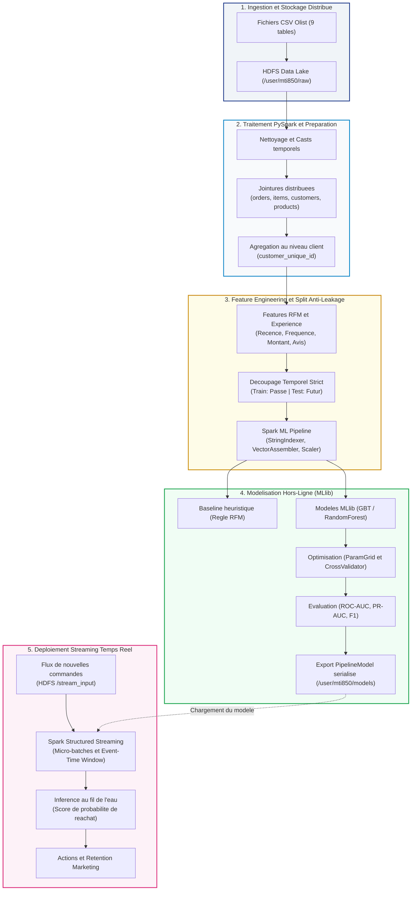

# MTI850 - Final Project: E-Commerce Customer Analytics & Repeat Purchase Prediction

## 1. Description du Projet

Ce projet implémente un pipeline d'analyse de données massives distribué de bout en bout avec **Apache Spark (PySpark)**, **HDFS (Hadoop Distributed File System)**, **Spark MLlib** et **Spark Structured Streaming**, appliqué au jeu de données public **Olist Brazilian E-Commerce**.

### Problematique d'affaires
Dans le secteur du commerce électronique, le coût d'acquisition de nouveaux clients est considérablement plus élevé que la fidélisation des clients existants. L'objectif est de prédire, à partir du comportement initial d'un client et de son historique de commande, s'il effectuera un **réachat** (*Repeat Purchase / Customer Retention*) dans une fenêtre d'observation future.

### Defi Big Data
- **Modèle de données relationnel multi-tables :** Intégration distribuée de 9 tables (commandes, articles, clients, produits, paiements, avis, vendeurs, géolocalisation).
- **Prévention stricte du Data Leakage :** Découpage temporel (*time-based train/test split*) respectant l'ordre chronologique des transactions plutôt qu'un split aléatoire.
- **Stockage et calcul distribués :** Déploiement d'un cluster HDFS multi-nœuds avec réplication des blocs et traitement parallèle.
- **Inférence en continu :** Déploiement du modèle entraîné hors-ligne sur un flux d'événements entrants (*Spark Structured Streaming*) avec calcul incrémental et fenêtrage temporel (*event-time windowing*).

---

## 2. Architecture de la Solution



---

## 3. Structure du Repertoire et Role des Composants

```text
mti850-ecommerce-analytics-projet-final/
|
|-- .gitignore                          # Exclusions Git (donnees brutes, blocs HDFS, caches)
|-- docker-compose.yml                  # Orchestration du cluster distribue multi-noeuds
|-- start-hdfs.sh                       # Script d'initialisation et de demarrage du NameNode
|-- init-datanode.sh                    # Script d'initialisation et de demarrage des DataNodes
|-- README.md                           # Documentation officielle du projet
|
|-- config/                             # Fichiers de configuration Hadoop / HDFS / YARN
|   |-- core-site.xml                   # Configuration du systeme de fichiers par defaut (HDFS 9000)
|   |-- hdfs-site.xml                   # Facteur de replication (2) et chemins de donnees NameNode/DataNode
|   |-- mapred-site.xml                 # Moteur MapReduce associe a YARN
|   |-- yarn-site.xml                   # Configuration du ResourceManager et des NodeManagers
|   `-- log4j.properties               # Niveaux de journalisation Hadoop
|
|-- data/
|   |-- create_samples.ps1              # Script PowerShell d'extraction d'echantillons reduits (100 lignes)
|   |-- raw/                            # Fichiers CSV bruts d'Olist (source locale montee dans le NameNode)
|   |-- processed/                      # Donnees preparees et transformees (ex. Parquet)
|   `-- stream_input/                   # Fichiers sources pour la simulation du streaming
|
|-- namenode/                           # Volume persistant : Metadonnees HDFS (fsimage, edits)
|-- datanode1/                          # Volume persistant : Blocs de donnees distribues (Noeud 1)
|-- datanode2/                          # Volume persistant : Blocs de donnees distribues (Noeud 2)
```

### Description detaillee des composants de l'infrastructure

- **namenode (Conteneur et Repertoire) :**
  Cerveau du cluster HDFS. Il maintient l'arborescence des fichiers, les permissions et la table de correspondance entre les fichiers et les blocs physiques distribues. Il n'enregistre pas directement les donnees des fichiers, mais uniquement les metadonnees (`fsimage` et `edits`).
- **datanode1 et datanode2 (Conteneurs et Repertoires) :**
  Noeuds de stockage esclaves. Ils stockent physiquement les blocs de donnees decoupés (128 Mo par defaut). Avec un facteur de replication de 2 (`dfs.replication = 2`), chaque bloc ecrit dans HDFS est clone sur `datanode1` et `datanode2`, garantissant la tolerance aux pannes.
- **config/core-site.xml :**
  Definit l'adresse racine du systeme de fichiers (`hdfs://namenode:9000`) accessible par tous les noeuds et futurs clients de calcul.
- **config/hdfs-site.xml :**
  Fixe le facteur de replication a 2 et declare les chemins internes de stockage `/opt/hadoop/data/nameNode` et `/opt/hadoop/data/dataNode`.
- **start-hdfs.sh :**
  Verifie si le NameNode a deja ete formate. Si ce n'est pas le cas, il execute le formatage initial (`hdfs namenode -format`) sans ecraser les donnees existantes lors des redemarrages futurs, puis lance le demon NameNode.
- **init-datanode.sh :**
  Configure le repertoire local du DataNode, applique les permissions requises pour l'utilisateur Hadoop et demarre le demon DataNode.
- **data/create_samples.ps1 :**
  Script PowerShell utilitaire extrayant automatiquement les 100 premieres lignes de chaque table brute (data/raw/*.csv) vers un sous-dossier d'echantillons. Il permet de prototyper, developper et tester rapidement la logique des scripts Spark en local sans devoir charger ni traiter les 126 Mo de donnees completes.
- **data/raw (Volume de donnees monte) :**
  Monte en lecture seule (`:ro`) dans le conteneur `namenode` sous `/data/raw`. Cela permet d'injecter directement les fichiers dans HDFS sans avoir recours a des commandes de copie intermediaires.

---

## 4. Guide de Deploiement et d'Utilisation

L'infrastructure fonctionne via **Docker Compose** sur un reseau interne isole nomme `hdfs_network` (`172.30.0.0/24`).

### Etape 1 : Preparation des donnees brutes
Telecharger le jeu de donnees public Olist depuis Kaggle :
[Brazilian E-Commerce Public Dataset by Olist](https://www.kaggle.com/datasets/olistbr/brazilian-ecommerce)

Placer l'ensemble des fichiers `.csv` extraits dans le dossier local :
`data/raw/`

Fichiers requis :
- `olist_customers_dataset.csv`
- `olist_geolocation_dataset.csv`
- `olist_orders_dataset.csv`
- `olist_order_items_dataset.csv`
- `olist_order_payments_dataset.csv`
- `olist_order_reviews_dataset.csv`
- `olist_products_dataset.csv`
- `olist_sellers_dataset.csv`
- `product_category_name_translation.csv`

---

### Etape 2 : Lancement du cluster HDFS

Depuis la racine du projet, lancer les services en arriere-plan :
```bash
docker compose up -d
```

Verifier que les conteneurs sont actifs :
```bash
docker compose ps
```

Vous devez voir les services `namenode`, `datanode1` et `datanode2` avec le statut `Up`.

---

### Etape 3 : Injection initiale des donnees dans HDFS (A executer une seule fois)

Comme le dossier local `data/raw` est monte automatiquement dans le NameNode sous `/data/raw`, l'injection s'effectue directement en ligne de commande.

1. Creer le repertoire cible dans HDFS :
```bash
docker compose exec namenode hdfs dfs -mkdir -p /user/mti850/raw
```

2. Charger tous les fichiers CSV dans HDFS :
```bash
docker compose exec namenode hdfs dfs -put /data/raw/*.csv /user/mti850/raw/
```

*Remarque :* Cette etape n'est requise qu'a la premiere initialisation. Les volumes Docker `namenode`, `datanode1` et `datanode2` persistent automatiquement toutes les donnees meme si vous arretez les conteneurs.

---

### Etape 4 : Verification du systeme et du stockage

#### 1. Verification par ligne de commande
Lister les fichiers charges dans HDFS :
```bash
docker compose exec namenode hdfs dfs -ls /user/mti850/raw
```
*Note d'observation :* La deuxieme colonne indique le chiffre `2`, confirmant que chaque fichier possede 2 repliques distribuees.

Verifier l'espace de stockage utilise :
```bash
docker compose exec namenode hdfs dfs -du -h /user/mti850/raw
```

Consulter le rapport de sante du cluster distribué :
```bash
docker compose exec namenode hdfs dfsadmin -report
```
Ce rapport doit indiquer `Live datanodes (2)` avec 0 bloc corrompu ou manquant.

#### 2. Verification par l'interface Web
Ouvrir votre navigateur a l'adresse suivante :
- **HDFS NameNode Web UI :** [http://localhost:9870](http://localhost:9870)

Depuis le menu **Utilities** -> **Browse the file system**, naviguer dans `/user/mti850/raw` pour visualiser l'ensemble des tables et leurs blocs distribues.

---

### Etape 5 : Arret du cluster

Pour arreter proprement l'ensemble des conteneurs :
```bash
docker compose down
```

Pour redemarrer ulterieurement le cluster sans perdre les donnees :
```bash
docker compose up -d
```

---

## 5. Ports Reseau et Services

| Service | Port Hote | Port Interne | Description |
|---|---|---|---|
| **HDFS NameNode Web UI** | `9870` | `9870` | Interface graphique de gestion HDFS et exploration de fichiers |
| **HDFS NameNode IPC** | - | `9000` | Port de communication inter-processus HDFS utilise par les DataNodes et Spark |
| **HDFS DataNode 1** | - | `9866` / `9867` | Transfert de donnees et statut du noeud 1 |
| **HDFS DataNode 2** | - | `9866` / `9867` | Transfert de donnees et statut du noeud 2 |
