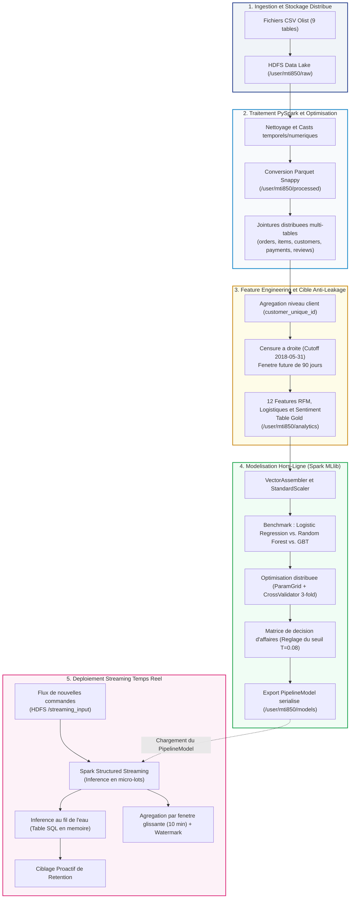

# MTI850 - Final Project: E-Commerce Customer Analytics & Repeat Purchase Prediction

## 1. Description du Projet

Ce projet implemente un pipeline d'analyse de donnees massives distribue de bout en bout avec **Apache Spark (PySpark)**, **HDFS (Hadoop Distributed File System)**, **Spark MLlib** et **Spark Structured Streaming**, applique au jeu de donnees public **Olist Brazilian E-Commerce**.

### Problematique d'affaires
Dans le secteur du commerce electronique, le cout d'acquisition de nouveaux clients est considerablement plus eleve que la fidelisation des clients existants. L'objectif est de predire, a partir du comportement initial d'un client et de son historique de commande, s'il effectuera un **reachat** (*Repeat Purchase / Customer Retention*) dans une fenetre d'observation future de 90 jours.

### Defi Big Data
- **Modele de donnees relationnel multi-tables :** Integration distribuee de 9 tables (commandes, articles, clients, produits, paiements, avis, vendeurs, geolocalisation).
- **Prevention stricte du Data Leakage :** Censure a droite (*right-censoring*) et fenetrage temporel strict respectant l'ordre chronologique des transactions.
- **Stockage et calcul distribues :** Deploiement d'un cluster HDFS multi-noeuds avec replication des blocs et traitement parallele.
- **Optimisation de stockage colonnaire :** Conversion Snappy Parquet permettant une reduction drastique des Entrees/Sorties (I/O).
- **Inference en continu :** Deploiement du modele entraine hors-ligne sur un flux d'evenements entrants (*Spark Structured Streaming*) avec calcul incremental, fenetrage temporel (*event-time windowing*) et gestion du retard (*watermarking*).

---

## 2. Architecture de la Solution



---

## 3. Structure du Repertoire et Role des Composants

```text
mti850-ecommerce-analytics-projet-final/
|
|-- .gitignore                          # Exclusions Git (donnees brutes, blocs HDFS, caches)
|-- docker-compose.yml                  # Orchestration du cluster distribue multi-noeuds
|-- start-hdfs.sh                       # Script d'initialisation et de demarrage du NameNode
|-- init-datanode.sh                    # Script d'initialisation et de demarrage des DataNodes
|-- README.md                           # Documentation officielle du projet
|
|-- config/                             # Fichiers de configuration Hadoop / HDFS / YARN
|   |-- core-site.xml                   # Configuration du systeme de fichiers par defaut (HDFS 9000)
|   |-- hdfs-site.xml                   # Facteur de replication (2) et chemins de donnees NameNode/DataNode
|   |-- mapred-site.xml                 # Moteur MapReduce associe a YARN
|   |-- yarn-site.xml                   # Configuration du ResourceManager et des NodeManagers
|   `-- log4j.properties               # Niveaux de journalisation Hadoop
|
|-- data/
|   |-- create_samples.ps1              # Script PowerShell d'extraction d'echantillons reduits (100 lignes)
|   |-- raw/                            # Fichiers CSV bruts d'Olist (source locale montee dans le NameNode)
|   |-- processed/                      # Donnees preparees et transformees (ex. Parquet)
|   `-- stream_input/                   # Fichiers sources pour la simulation du streaming
|
|-- namenode/                           # Volume persistant : Metadonnees HDFS (fsimage, edits)
|-- datanode1/                          # Volume persistant : Blocs de donnees distribues (Noeud 1)
|-- datanode2/                          # Volume persistant : Blocs de donnees distribues (Noeud 2)
|
|-- notebooks/                          # Notebooks Jupyter interactifs
|   |-- 1.0 hello_spark.ipynb           # Validation de la connexion PySpark vers HDFS
|   |-- 2.1 optimisation_et_nettoyage.ipynb   # Sprint 2.1 : Ingestion CSV vers Parquet (gain 69.2%)
|   |-- 2.2 exploration_et_cible.ipynb        # Sprint 2.2 : Jointures, cohorte et feature engineering
|   |-- 3.1_modelisation_retention.ipynb      # Sprint 3 : Modeles MLlib, evaluation et seuillage
|   `-- 4.0_projet_final_complet.ipynb        # Notebook unifie complet de bout en bout (Remise finale)
|
`-- src/                                # Scripts Python et modules utilitaires
```

### Description detaillee des composants de l'infrastructure

- **namenode (Conteneur et Repertoire) :**
  Cerveau du cluster HDFS. Il maintient l'arborescence des fichiers, les permissions et la table de correspondance entre les fichiers et les blocs physiques distribues. Il n'enregistre pas directement les donnees des fichiers, mais uniquement les metadonnees (`fsimage` et `edits`).
- **datanode1 et datanode2 (Conteneurs et Repertoires) :**
  Noeuds de stockage esclaves. Ils stockent physiquement les blocs de donnees decoupes (128 Mo par defaut). Avec un facteur de replication de 2 (`dfs.replication = 2`), chaque bloc ecrit dans HDFS est clone sur `datanode1` et `datanode2`, garantissant la tolerance aux pannes.
- **config/core-site.xml :**
  Definit l'adresse racine du systeme de fichiers (`hdfs://namenode:9000`) accessible par tous les noeuds et futurs clients de calcul.
- **config/hdfs-site.xml :**
  Fixe le facteur de replication a 2 et declare les chemins internes de stockage `/opt/hadoop/data/nameNode` et `/opt/hadoop/data/dataNode`.
- **start-hdfs.sh :**
  Verifie si le NameNode a deja ete formate. Si ce n'est pas le cas, il execute le formatage initial (`hdfs namenode -format`) sans ecraser les donnees existantes lors des redemarrages futurs, puis lance le demon NameNode.
- **init-datanode.sh :**
  Configure le repertoire local du DataNode, applique les permissions requises pour l'utilisateur Hadoop et demarre le demon DataNode.
- **spark-notebook (Conteneur) :**
  Environnement de travail et client de calcul base sur l'image officielle `jupyter/pyspark-notebook`. Il embarque Apache Spark, Python 3 et JupyterLab. Connecte au reseau `hdfs_network`, il execute le code PySpark en mode local distribue et accede directement a HDFS via l'adresse `hdfs://namenode:9000`. Le dossier racine du projet est monte dans `/home/jovyan/work`.
- **data/create_samples.ps1 :**
  Script PowerShell utilitaire extrayant automatiquement les 100 premieres lignes de chaque table brute (`data/raw/*.csv`) vers un sous-dossier d'echantillons pour le prototypage rapide.
- **data/raw (Volume de donnees monte) :**
  Monte en lecture seule (`:ro`) dans le conteneur `namenode` sous `/data/raw`. Cela permet d'injecter directement les fichiers dans HDFS sans avoir recours a des commandes de copie intermediaires.

---

## 4. Guide de Deploiement et d'Utilisation

L'infrastructure fonctionne via **Docker Compose** sur un reseau interne isole nomme `hdfs_network` (`172.30.0.0/24`).

### Etape 1 : Preparation des donnees brutes
Telecharger le jeu de donnees public Olist depuis Kaggle :
[Brazilian E-Commerce Public Dataset by Olist](https://www.kaggle.com/datasets/olistbr/brazilian-ecommerce)

Placer l'ensemble des fichiers `.csv` extraits dans le dossier local :
`data/raw/`

Fichiers requis :
- `olist_customers_dataset.csv`
- `olist_geolocation_dataset.csv`
- `olist_orders_dataset.csv`
- `olist_order_items_dataset.csv`
- `olist_order_payments_dataset.csv`
- `olist_order_reviews_dataset.csv`
- `olist_products_dataset.csv`
- `olist_sellers_dataset.csv`
- `product_category_name_translation.csv`

---

### Etape 2 : Lancement du cluster HDFS

Depuis la racine du projet, lancer les services en arriere-plan :
```bash
docker compose up -d
```

Verifier que les conteneurs sont actifs :
```bash
docker compose ps
```

Vous devez voir les 4 services `namenode`, `datanode1`, `datanode2` et `spark-notebook` avec le statut `Up`.

---

### Etape 3 : Injection initiale des donnees dans HDFS (A executer une seule fois)

Comme le dossier local `data/raw` est monte automatiquement dans le NameNode sous `/data/raw`, l'injection s'effectue directement en ligne de commande.

1. Creer le repertoire cible dans HDFS :
```bash
docker compose exec namenode hdfs dfs -mkdir -p /user/mti850/raw
```

2. Charger tous les fichiers CSV dans HDFS :
```bash
docker compose exec namenode hdfs dfs -put /data/raw/*.csv /user/mti850/raw/
```

*Remarque :* Cette etape n'est requise qu'a la premiere initialisation. Les volumes Docker `namenode`, `datanode1` et `datanode2` persistent automatiquement toutes les donnees meme si vous arretez les conteneurs.

---

### Etape 4 : Verification du systeme et du stockage

#### 1. Verification par ligne de commande
Lister les fichiers charges dans HDFS :
```bash
docker compose exec namenode hdfs dfs -ls /user/mti850/raw
```
*Note d'observation :* La deuxieme colonne indique le chiffre `2`, confirmant que chaque fichier possede 2 repliques distribuees.

Verifier l'espace de stockage utilise :
```bash
docker compose exec namenode hdfs dfs -du -h /user/mti850/raw
```

Consulter le rapport de sante du cluster distribue :
```bash
docker compose exec namenode hdfs dfsadmin -report
```
Ce rapport doit indiquer `Live datanodes (2)` avec 0 bloc corrompu ou manquant.

#### 2. Verification par les interfaces Web
- **HDFS NameNode Web UI :** [http://localhost:9870](http://localhost:9870)
  Depuis le menu **Utilities** -> **Browse the file system**, naviguer dans `/user/mti850/raw` pour visualiser l'ensemble des tables et leurs blocs distribues.
- **JupyterLab :** [http://localhost:8888](http://localhost:8888)
  Acceder a l'environnement de developpement avec le jeton d'acces : `mti850`.
- **Spark Application UI :** [http://localhost:4040](http://localhost:4040)
  Consulter le graphe d'execution (DAG), les jobs et les stages d'une session Spark active.

#### 3. Verification de la connexion PySpark vers HDFS
Executer le notebook de validation `notebooks/1.0 hello_spark.ipynb` dans JupyterLab pour confirmer la lecture directe de 99 441 clients et 99 441 commandes depuis le port 9000 du NameNode.

---

### Etape 5 : Execution des Notebooks et Pipeline Analytique

Deux modes d'execution sont a la disposition de l'utilisateur :

#### Mode A : Execution par Sprints Incrementaux
1. **`notebooks/2.1 optimisation_et_nettoyage.ipynb`** :
   Charge les CSV bruts depuis `/user/mti850/raw/`, applique le typage strict (`TimestampType`, `DoubleType`), filtre les anomalies et sauvegarde les tables nettoyees au format Snappy Parquet dans `/user/mti850/processed/` (gain d'espace mesure : 69.2%).
2. **`notebooks/2.2 exploration_et_cible.ipynb`** :
   Realise les jointures distribuees, isole la cohorte de 75 257 premiers acheteurs, applique la censure a droite au 2018-05-31 pour eviter tout Data Leakage, calcule les 12 features analytiques et enregistre la table finale dans `/user/mti850/analytics/first_orders_features.parquet`.
3. **`notebooks/3.1_modelisation_retention.ipynb`** :
   Entraine les modeles de classification MLlib (Logistic Regression, Random Forest, GBT), calibre le seuil optimal de decision ($T=0.08$) et simule l'inference en streaming.

#### Mode B : Notebook Maitre Unifie (Remise Finale)
Le notebook **`notebooks/4.0_projet_final_complet.ipynb`** regroupe l'integralite du pipeline dans un document unique et autonome. En cellule 4, une bascule permet de selectionner le mode de demarrage :
- **Option A (`run_full_etl = True`)** : Rejoue l'integralite des etapes d'ingestion, de conversion Parquet, de jointure et de feature engineering a partir des CSV bruts.
- **Option B (`run_full_etl = False`)** : Charge instantanement la table preparee `first_orders_features.parquet` issue des sprints precedents pour se concentrer directement sur la modelisation, la validation croisee (`CrossValidator`), le seuillage d'affaires et le Structured Streaming.

---

### Etape 6 : Arret du cluster

Pour arreter proprement l'ensemble des conteneurs :
```bash
docker compose down
```

Pour redemarrer ulterieurement le cluster sans perdre les donnees :
```bash
docker compose up -d
```

---

## 5. Ports Reseau et Services

| Service | Port Hote | Port Interne | Description |
|---|---|---|---|
| **JupyterLab** | `8888` | `8888` | Environnement interactif PySpark (jeton : `mti850`) |
| **Spark Application UI** | `4040` | `4040` | Suivi des jobs Spark, stages et graphes DAG en temps reel |
| **HDFS NameNode Web UI** | `9870` | `9870` | Interface graphique de gestion HDFS et exploration de fichiers |
| **HDFS NameNode IPC** | - | `9000` | Port de communication inter-processus HDFS utilise par les DataNodes et Spark |
| **HDFS DataNode 1** | - | `9866` / `9867` | Transfert de donnees et statut du noeud 1 |
| **HDFS DataNode 2** | - | `9866` / `9867` | Transfert de donnees et statut du noeud 2 |

---

## 6. Synthese des Resultats Quantitatifs et Benchmarks

### 6.1 Optimisation du Stockage Distribue (CSV vs. Parquet)

La conversion des 9 tables relationnelles brutes en format colonnaire compresse avec Snappy a permis de depasser largement l'objectif de reduction de 60 % :

| Format de Stockage | Emplacement HDFS | Taille Totale Disque | Reduction d'espace |
| :--- | :--- | :---: | :---: |
| **CSV Brut (Bronze)** | `/user/mti850/raw/` | 126.0 Mo | Reference (0 %) |
| **Parquet Snappy (Silver)** | `/user/mti850/processed/` | **38.8 Mo** | **-69.2 %** |

Ce gain reduit drastiquement la bande passante reseau lors des lectures analytiques grace a la projection colonnaire et au pushdown de predicats Catalyst.

### 6.2 Cohorte Analytique et Desequilibre de Classes

- **Taille de la cohorte des premiers achats :** 75 257 clients uniques (`customer_unique_id`).
- **Date seuil de censure a droite :** `2018-05-31` (garantit une fenetre d'observation future complete de 90 jours pour chaque client, sans fuite d'information).
- **Distribution de la cible (`did_purchase_again`) :**
  - Classe 0 (Pas de reachat a 90 jours) : 73 543 clients (**97.72 %**)
  - Classe 1 (Reachat effectue a 90 jours) : 1 714 clients (**2.28 %**)
- **Implication methodologique :** L'exactitude globale (*Accuracy*) est une metrique trompeuse (un predicteur constant obtiendrait 97.7 % sans rien predire). L'aire sous la courbe Precision-Rappel (**PR-AUC**) constitue la metrique d'evaluation principale (seuil aleatoire = 0.0228).

### 6.3 Benchmark des Modeles de Machine Learning (Spark MLlib)

Evaluation rigoureuse sur le jeu de test independant (20 % de la cohorte, 15 119 clients) :

| Modele | ROC-AUC | PR-AUC | Gain relatif vs. Baseline aleatoire (PR-AUC) |
| :--- | :---: | :---: | :---: |
| **Predicteur Aleatoire (Baseline)** | 0.5000 | 0.0228 | 1.0x |
| **Logistic Regression** | 0.6172 | 0.1162 | 5.1x |
| **Random Forest** | 0.6295 | 0.1312 | 5.8x |
| **Gradient-Boosted Trees (GBT Initial)** | 0.6372 | 0.1377 | 6.0x |
| **Champion : GBT Optimise (CrossValidator 3-fold)** | **0.6372** | **0.1420** | **6.2x** |

L'optimisation des hyperparametres (`maxDepth=4`, `maxIter=10`) a permis de regulariser les arbres boostes face au bruit statistique des classes rares, hissant le PR-AUC a 0.1420.

### 6.4 Matrice de Decision d'Affaires et Optimisation du Seuil

Avec le seuil par defaut de $T = 0.50$, le modele predit 0 pour l'ensemble des clients en raison de l'asymetrie des classes (Rappel = 0 %). L'analyse de la courbe Precision-Rappel a permis de definir le seuil d'activation optimal pour le marketing proactif :

| Seuil de Decision ($T$) | Precision | Rappel | F1-Score | Clients Cibles (Sur 15 119) | Vrais Acheteurs Identifies | Gain vs. Ciblage Aleatoire |
| :---: | :---: | :---: | :---: | :---: | :---: | :---: |
| $T = 0.02$ | 4.88 % | 78.43 % | 0.0919 | 6 122 | 299 | 1.9x |
| $T = 0.04$ | 15.30 % | 43.83 % | 0.2268 | 1 091 | 167 | 6.0x |
| **$T = 0.08$ (Seuil Optimal)** | **47.83 %** | **11.67 %** | **0.1876** | **92** | **44** | **18.9x** |
| $T = 0.10$ | 52.17 % | 6.28 % | 0.1121 | 46 | 24 | 20.6x |
| $T = 0.50$ (Defaut standard) | 0.00 % | 0.00 % | 0.0000 | 0 | 0 | - |

**Recommandation d'affaires :** En ciblant les clients depassant la probabilite de $T = 0.08$, l'equipe marketing atteint un taux de conversion de **47.83 %** (presque 1 client cible sur 2 effectue reellement un reachat), representant un gain d'efficacite de **18.9 fois** superieur a une campagne a l'aveugle.

### 6.5 Deploiement Streaming en Continu (Spark Structured Streaming)

- **Persistance :** Export du modele complet sous forme de `PipelineModel` (`/user/mti850/models/gbt_retention_pipeline_model`).
- **Inference en micro-lots :** Lecture continue depuis `/user/mti850/streaming_input/` et calcul direct du score de probabilite au fil de l'eau.
- **Gestion du retard et fenetrage temporel :** Application de `withWatermark("event_timestamp", "10 minutes")` et agregation glissante par fenetres de 10 minutes (glissement de 5 minutes) assurant le suivi volumetrique temps reel des flux de commandes sans accumulation d'etat memoire.
